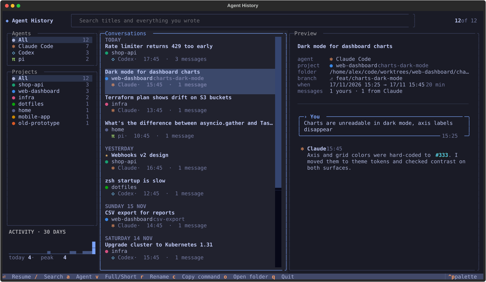
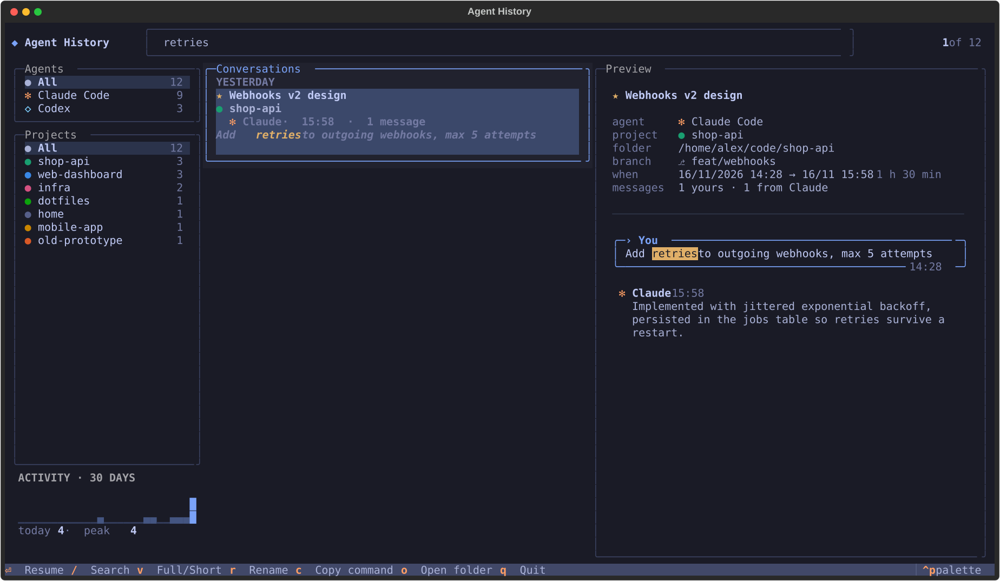

# ◆ agent-history

**One history for all your AI coding agents.** A terminal app to browse, search and resume
every conversation you've had with any of your coding agents, across all your projects, in one list.



Every coding agent keeps its own sessions, in its own format, behind its own resume picker. If you
use more than one, or just want to find *that* conversation from last week, you end up opening
them one by one. `agent-history` puts them all in one place, like the chat list of a desktop app,
in your terminal:

- **Every session, in one place.** All your agents together, grouped by day, with the title the
  agent generated (or the one you gave it), the project, the worktree, the time and how many
  messages you wrote. Each row says which agent it was.
- **Full-text search.** Type to filter titles, folders, branches *and everything you wrote*.
  Matches are highlighted, and when the match is in the text you see the sentence it came from.
- **Preview before you open.** Your messages and the agent's replies, rendered as Markdown.
- **Filter by agent and by project**, with counts that follow your search. Sessions are grouped
  by repository, so git worktrees count as the same project.
- **Resume with Enter.** It `cd`s into the original folder and hands off to the agent's own
  resume command. If that folder was deleted (a removed worktree), it recreates it so the
  session can still be resumed.
- **Choose your agents.** Switch agents on or off from the app; the choice is saved in a config file.
- **Rename** a conversation, **copy** its resume command, or **open** its folder.
- Fast: the index is cached and only changed sessions are re-read.
- English and Italian UI.



## Supported agents

| Agent | Sessions read from | Resumed with | Notes |
|---|---|---|---|
| ✻ [Claude Code](https://docs.claude.com/en/docs/claude-code) | `~/.claude/projects/` (`CLAUDE_CONFIG_DIR`) | `claude --resume <id>` | Rename supported. Deletes sessions after 30 days by default, [see below](#keep-your-history-longer) |
| ◇ [Codex](https://github.com/openai/codex) | `~/.codex/sessions/` (`CODEX_HOME`) | `codex resume <id>` | Titles from `session_index.jsonl`; sub-agent sessions (approval reviews) are hidden |
| π [pi](https://pi.dev/) | `~/.pi/agent/sessions/` (`PI_CODING_AGENT_DIR`, `PI_CODING_AGENT_SESSION_DIR`, `sessionDir` setting) | `pi --session <file>` | Sessions are trees: shows the branch you were last on |

You only need the agents you actually use: the others are simply skipped, and with a single
agent the agents list is hidden.

**Missing your agent?** [Open an issue](https://github.com/formich/agent-history/issues) with
its name and, ideally, a small sample session file, or see [Adding an agent](#adding-an-agent).

## Install

You need [uv](https://docs.astral.sh/uv/) (it fetches Python 3.11+ and
[Textual](https://textual.textualize.io/) on first run, nothing is installed globally).

Download the latest release into a folder on your `PATH`:

```sh
curl -fsSL https://github.com/formich/agent-history/releases/latest/download/agent-history \
  -o ~/.local/bin/agent-history && chmod +x ~/.local/bin/agent-history
```

Run the same command again to update. To pin a version, replace `latest/download` with
`download/v1.2.0`; every [release](https://github.com/formich/agent-history/releases) also
ships a `SHA256SUMS` file if you want to verify the download.

Or, to follow development, clone the repo and symlink the script:

```sh
git clone https://github.com/formich/agent-history.git
ln -s "$PWD/agent-history/agent-history" ~/.local/bin/agent-history
```

Works on macOS and Linux.

## Use

```sh
agent-history                 # open the app
agent-history webhook         # open it with a search already typed
agent-history --agent codex   # only one agent's conversations (claude, codex, pi, …)
agent-history --list          # plain list, for scripts
```

| Key | Action |
|---|---|
| `Enter` | Resume the selected conversation in its folder |
| `/` | Search (`Esc` clears it, `Esc` again goes back to the list) |
| `a` | Cycle through the agents (All → each agent) |
| `s` | Choose which agents to include (saved to the config file) |
| `v` | Toggle the whole conversation / short preview |
| `r` | Rename the conversation, shown with ★ (where the agent supports it) |
| `c` | Copy the command that resumes it |
| `o` | Open the folder in Finder / your file manager |
| `p` | Jump to the projects list |
| `Tab` | Move between panes |
| `Ctrl+P` | Command palette (themes, quit, …) |
| `q` | Quit |

## Keep your history longer

Some agents clean up old sessions on their own. Claude Code, for example, **deletes sessions
older than 30 days** by default. To keep them, raise `cleanupPeriodDays` in
`~/.claude/settings.json`:

```json
{
  "cleanupPeriodDays": 365
}
```

## Configuration

### Agents to include

Press `s` in the app to switch agents on or off, or edit
`~/.config/agent-history/config.toml` (created the first time you save from the app). Agents
missing from the file are on:

```toml
[agents]
claude = true
codex = false
pi = true
```

Switched-off agents are not read at all, so start-up is faster too. `--agent X` still shows
agent X for that run, even if it's switched off.

### Environment variables

All optional. Each agent's own data-directory variable is honoured too (see
[Supported agents](#supported-agents)).

| Variable | Default | Meaning |
|---|---|---|
| `AGENT_HISTORY_LANG` | from `LANG` | `en` or `it` |
| `AGENT_HISTORY_CONFIG` | `~/.config/agent-history/config.toml` | Config file path (`$XDG_CONFIG_HOME` is honoured) |
| `AGENT_HISTORY_ROOTS` | `Dev:dev:code:src:projects:repos:git:workspace:Developer` | Folders under `$HOME` that contain your repos; the next path segment becomes the project name |

## How it works

Coding agents store each session as a local file, usually JSON Lines. `agent-history` reads
those files (read-only, except when you rename a conversation where the agent supports it),
keeps a small index in `~/.cache/agent-history/`, and hands off to the agent's own resume
command when you pick one.

Projects are recognised from the session's folder: `~/<root>/<repo>/…` (see
`AGENT_HISTORY_ROOTS`), git worktrees in `…/worktrees/<repo>/<name>` and agent-managed
worktrees such as `<repo>/.claude/worktrees/<name>` all count as `<repo>`.

This is an unofficial tool, not affiliated with the makers of any of the agents it supports.
Session formats are internal to each agent and may change; if something breaks after an
update, please open an issue.

## Adding an agent

The goal is to cover as many coding agents as possible, and adding one is self-contained.
Everything lives in the single `agent-history` script:

1. **`AGENTS`**: add an entry with its display name, a one-character glyph and a colour.
2. **A scanner**: a `scan_<agent>(path)` function that turns one session file into the common
   record (id, folder, title, your prompts, timestamps, message counts). Use the existing
   `scan_claude`, `scan_codex` and `scan_pi` as templates.
3. **A message reader**: `<agent>_messages(path)` yielding `(role, timestamp, text)` for the
   preview, and register it in `messages_of`.
4. **`SOURCES`**: how to find its session files.
5. **`resume_argv`**: the command that resumes a session.
6. **Docs and screenshots**: a row in [Supported agents](#supported-agents) and a couple of
   invented sessions in `scripts/screenshot.py`.

Please test with real session files from the agent, and never commit real conversations.

## Screenshots

The screenshots are generated from invented sessions by `scripts/screenshot.py`:

```sh
uv run --with 'textual>=1.0' python scripts/screenshot.py           # docs/screenshot.svg
uv run --with 'textual>=1.0' python scripts/screenshot.py retries   # docs/screenshot-search.svg
```

## License

[MIT](LICENSE)
